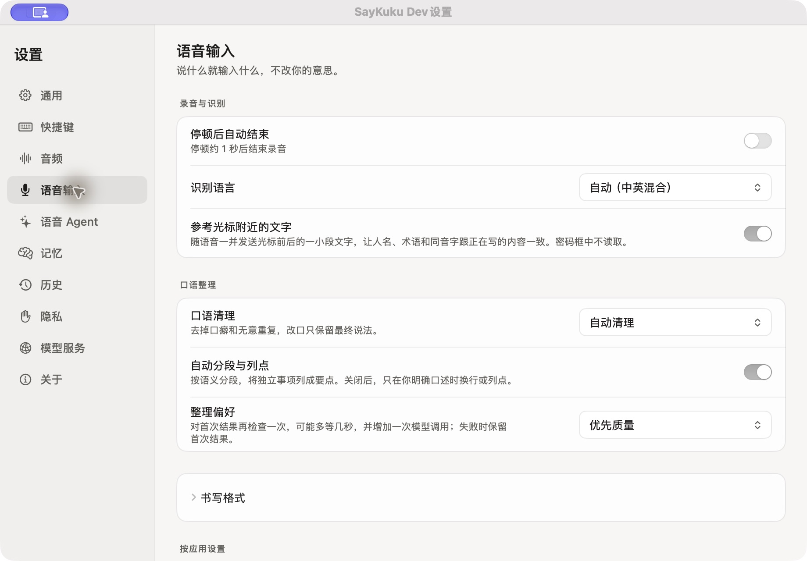
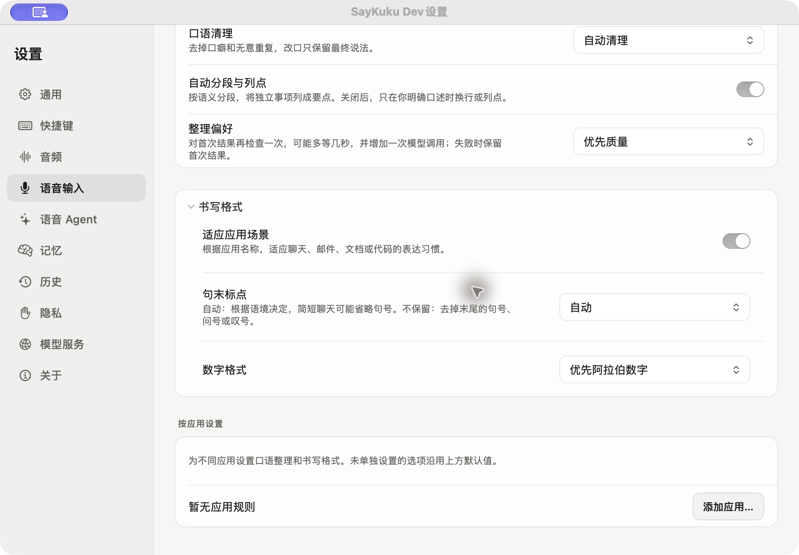
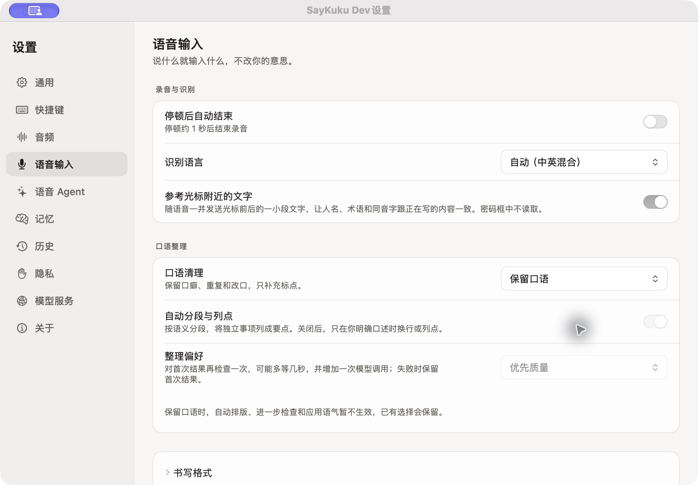
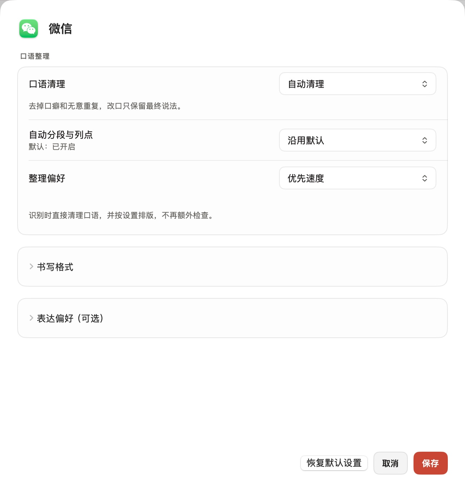

# 语音输入设置

“口语清理”“自动分段与列点”和“整理偏好”分别控制清理、排版与追加检查。用户可自由组合，按应用覆盖与默认配置使用相同选项。

| 分组 | 选项 | 默认值与行为 |
| --- | --- | --- |
| 录音与识别 | 停顿后自动结束、识别语言、参考光标附近的文字 | 沿用现有默认值和隐私边界 |
| 口语整理 | 口语清理 | 自动清理：去掉口癖和无意重复，改口保留最终说法；保留口语：保留口头表达，只补标点 |
| 口语整理 | 自动分段与列点 | 开启；关闭后仍清理口语，保留明确口述的格式 |
| 口语整理 | 整理偏好 | 优先质量：首次识别后追加文本检查，失败保留首稿；优先速度：只做首次识别中的清理和排版 |
| 书写格式（折叠） | 适应应用场景、句末标点、数字格式 | 默认适应应用场景、自动句末标点、优先阿拉伯数字；“自动”允许简短聊天省略句号 |
| 按应用设置 | 以上整理和书写选项 | 可沿用默认，或为该应用单独指定；默认值在副文案中显示一次 |
| 按应用设置 | 表达偏好（可选、折叠） | 仅补充表达习惯，不代替以上选项，也不能改变原意或删掉细节 |

保留口语时，自动排版、追加检查和应用语气暂不生效，已保存的选项不会清空。全局保留口语时，应用仍可单独选择自动清理。关闭自动分段与列点不会降低长文本的整理档位或等待预算。

已发布的原样／轻度／二次整理模式及更早的独立开关均保留有效行为。按应用新增的排版、整理偏好可为空，旧记录自然继承默认值。录音开始时固定有效配置，录音中的设置变化影响下一次输入。

## 实际界面

以下截图来自本机签名开发构建。交互检查后，已恢复测试前的清理、排版、整理偏好及空应用规则列表。

### 默认配置

### 展开书写格式

### 保留口语

### 按应用覆盖

全局保留口语时，微信仍可单独自动清理，并选择优先速度。自动排版继续沿用默认；恢复默认设置会移除该应用的独立规则。

## 验证

离线覆盖旧配置迁移、可空字段兼容、继承和覆盖、录音快照、Realtime／批处理恢复／批处理路径及历史重试。开发包通过签名校验，并在原生界面验证折叠、禁用提示、覆盖、保存、重新编辑和恢复默认设置。

新增模型检查使用 `SAYKUKU_LIVE_QWEN_TEST=1 SAYKUKU_CLEANUP_SETTINGS_EVAL=1` 显式开启，另需设置测试 Workspace ID 和区域。4 个 Flash 场景与 2 个 Realtime 场景全部通过：长文关闭／开启自动排版、关闭时保留已有列表、短疑问句清理、相同缓存短音频的排版关闭／开启。首次运行漏配 Workspace ID，文本部分通过后在音频请求前停止；补齐配置后的完整运行 6/6。它们是设置行为的定向检查，不代替完整质量评测。

各方案的长短语音结果与局限见 [统一评测报告](DICTATION_UNIFIED_EVAL_2026-10-25.md)。
